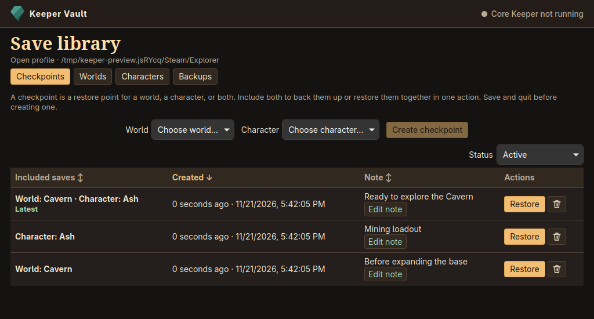

# Keeper Vault

A Linux desktop save manager for Core Keeper. Checkpoint a world, a character, or both. Restoring automatically backs up your current progress.



## Run

With Node.js 22.18+, npm, GNU Make, Git, a C compiler, GJS, GTK 3, and WebKitGTK 4.1 installed:

```sh
make run
```

Make fetches V if needed. To select a save profile, use `make run PROFILE="/path/to/profile"`.

## Develop

V backend in `backend/`, Solid UI in `ui/`. Run `make fmt` to format and `make check BROWSER=/path/to/chromium` to build and test.
